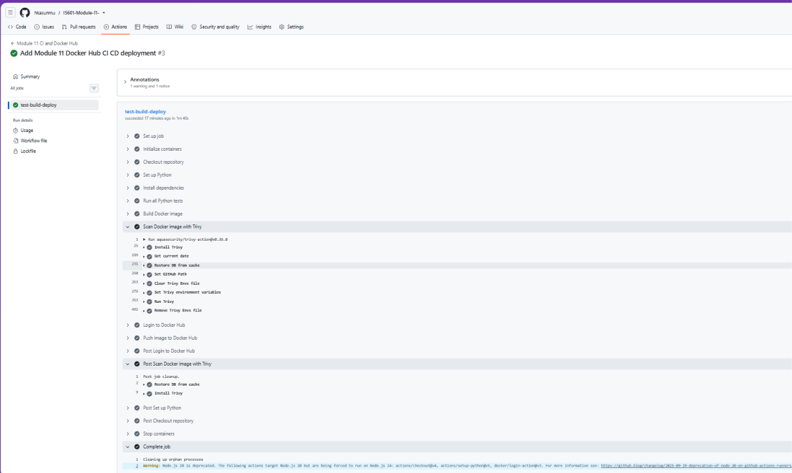
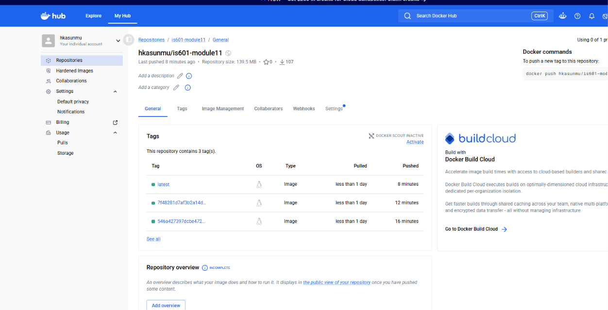

# IS601 Module 11 - Calculation Model

## Project Overview

For Module 11, I built on my previous Python,
FastAPI, and PostgreSQL assignments.

I created a Calculation model using SQLAlchemy,
added Pydantic validation, and implemented a
Factory Pattern for arithmetic operations.

## Features

- SQLAlchemy Calculation model
- Pydantic input and output validation
- Addition, Subtraction, Multiplication, Division
- Factory Pattern
- Division-by-zero validation
- PostgreSQL database integration
- Automated pytest testing
- GitHub Actions CI/CD
- Docker Hub deployment

## Technologies Used

Python, FastAPI, PostgreSQL, SQLAlchemy,
Pydantic, pytest, Docker, and GitHub Actions.

## Running the Project

1. Clone the GitHub repository.
2. Open the project folder in VS Code.
3. Install the dependencies:

   py -m pip install -r requirements.txt

4. Create a .env file containing:
   POSTGRES_PASSWORD
   PGADMIN_DEFAULT_EMAIL
   PGADMIN_DEFAULT_PASSWORD

5. Start PostgreSQL:

   docker compose up -d db

6. Configure DATABASE_URL using the PostgreSQL
   username, your password, localhost port 5434,
   and the fastapi_db database.

7. Run all tests:

   py -m pytest -v

## Testing Results

All 22 tests passed during local testing.

Tests cover:
- Arithmetic operations
- Pydantic schema validation
- Invalid calculation types
- Division by zero
- Database storage
- PostgreSQL integration
- Existing user functionality

## CI/CD Pipeline

GitHub Actions successfully:
- Installed project dependencies
- Ran automated Python tests
- Built the Docker image
- Completed Trivy security scanning
- Pushed the image to Docker Hub

## Docker Hub

Docker repository:
https://hub.docker.com/r/hkasunmu/is601-module11

Pull the Docker image:

   docker pull hkasunmu/is601-module11:latest

The application requires PostgreSQL configuration
to use database-dependent functionality.

## GitHub Repository

https://github.com/hkasunmu/IS601-Module-11-

## Submission Screenshots

### GitHub Actions

### Docker Hub

## Reflection

My Module 11 reflection is available in
MODULE11_REFLECTION.md.
